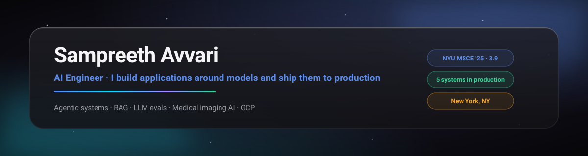

  

  
  
  
  

I'm a forward deployed engineer at **Hybridge Implants** in New York. My job is the whole distance: sit with the people who have the problem, design the system, build it, ship it on Google Cloud, and keep it alive with real users.

MS in Computer Engineering from **NYU**, May 2025, 3.9 GPA. Before that, backend audio analytics at **Shure** and enterprise AI infrastructure at **Optimal Living Systems**. Credited for data engineering in a 2026 *Telecommunications Policy* paper on intangible assets and state GDP.

### Every system I run, drawn

I'm the only engineer at a three office dental implant practice, and I run about 45 services there on Google Cloud. Each system has a live, clickable architecture drawing on my site: the parts, what each one does when it fails, the guards, and the monthly cost where billing measures it.

**[sampreethavvari.com](https://sampreethavvari.com)** · **[All drawings](https://sampreethavvari.com/architecture)**

* **[Hybridge Platform](https://sampreethavvari.com/architecture/platform)**: 45 services on 14 Google Cloud projects and how they connect.
* **[Capacity Planner](https://sampreethavvari.com/architecture/capacity-planner)**: syncs Denticon into the planner every minute, read only.
* **[Doc Coach](https://sampreethavvari.com/architecture/doc-coach)**: grades each recorded Zoom consult with Gemini.

Along the way: about $460K of patient value found that no report showed, an engine that does the 70 hours a week of reading the insurance team did by hand, and 1,161 doctor consults and patient calls graded.

---

### What I actually do with AI

Every line below is backed by something I run.

**Agentic AI and orchestration.** I build multi-step agent systems: tool use and function calling, MCP servers, headless LLM pipelines that plan, act, and verify. My job application agent screens postings, tailors materials against a locked profile, and applies with human review gates. My work journal agent sweeps 35 project folders twice a day, reads git diffs and session transcripts, and writes the day's engineering log by itself.

**RAG and retrieval.** Embeddings, pgvector, chunking strategy, and the part people skip: retrieval evaluation. My portfolio chatbot answers from a knowledge graph built over my own projects and writing. At work, an enterprise search system makes ten years of clinical documents answerable.

**LLM engineering.** Structured outputs enforced with JSON Schema, prompt design treated as an interface contract, hallucination measurement and reduction, model evals wired into CI so quality regressions fail the build instead of reaching users.

**Fine-tuning and alignment.** SFT and RLHF (GRPO and PPO) with QLoRA and TRL on Llama 3.1 for NYU research on LLM persuasion; fine-tuned Llama 3 8B and RoBERTa on 1.8M tweets for misinformation work.

**Applied computer vision.** A 3D medical imaging checker for dental CT scans: MONAI and PyTorch training, OpenVINO inference on Cloud Run. In testing on real scans it flagged 26 of the 30 bad studies our team marked, and it cost $62 on Google Cloud in October 2026 against a vendor quote of $2,200 a month.

**Platform and MLOps.** GCP end to end: Cloud Run, Cloud SQL, Pub/Sub, Eventarc, Vertex AI, Firestore. Docker, Kubernetes, Terraform, GitHub Actions with release gates, OpenTelemetry, MLflow, Weights & Biases. Systems earn their keep after the demo, so observability and CI/CD go in at the design stage.

---

### Systems I built and run

| System | What it does | Proof it matters |
|---|---|---|
| **Doc Coach** | Scores every recorded implant consult against the CEO's seven criteria: Zoom to Gemini to a coaching report, on Cloud Run | 1,161 doctor consults and patient calls graded with NPC Coach; weekly report cards land Monday at 8 AM |
| **Cowork Dashboard** | One snapshot of the Monday boards for leadership, with every metric defined once | Fixing the patient to lead join surfaced about $460K of patient value nobody had attributed |
| **Reconciliation** | Reads a day's schedule, ledger and notes exports and returns only the patients whose billing, notes or doctor disagree | Takes on the 70 hours a week the insurance team spent reading those exports by hand |
| **Treatment Estimator** | Quoting app for three offices; every saved line carries its price, tier and price book version | A saved quote keeps its price when an office changes its price book |
| **CBCT Scan Validator** | Flags unusable dental CT scans before a designer opens the case, with a verdict PDF | 26 of 30 bad studies flagged in testing; $62 a month against a $2,200 a month vendor quote |

Take the [interactive system tours](https://sampreethavvari.github.io/ai-systems-tours/), sanitized synthetic data walkthroughs of each system, or open the [architecture drawings](https://sampreethavvari.com/architecture) and longer stories on the [portfolio site](https://sampreethavvari.com).

---

### Stack

**Languages** Python, TypeScript, Go, Java, SQL
**AI/ML** PyTorch, Transformers, TRL, MONAI, OpenVINO, LangChain, pgvector, Gemini and Claude APIs, MCP
**Backend and web** FastAPI, Next.js, Node.js, Flask, Spring Boot, Postgres, Firestore
**Cloud and infra** GCP (Cloud Run, Cloud SQL, Pub/Sub, Eventarc, Vertex AI), AWS (S3, ECS, EC2), Docker, Kubernetes, Terraform, GitHub Actions
**Quality** OpenTelemetry, MLflow, Weights & Biases, JSON Schema validation, eval harnesses in CI

---

### How I work

- Spec before code. Tradeoffs and decisions live in the repo.
- One source of truth. If two views can disagree on a number, they eventually will.
- Honest evals over green dashboards. Ship the real AUROC, never game the gate.
- Boring tech where it serves the user. A weekly Excel pipeline the team trusts beats a live dashboard nobody does.

---

### Off keyboard

I write, edit, and direct films, credited as Sampreeth Sharma. The latest is [Among Monsters](https://www.imdb.com/title/tt39700295/) (2026), a crime drama shot in New York. Equally happy arguing about story structure or system design.

  New York, NY · <a href="mailto:spa9659@nyu.edu">spa9659@nyu.edu</a> · <a href="https://sampreethavvari.com">sampreethavvari.com</a>

